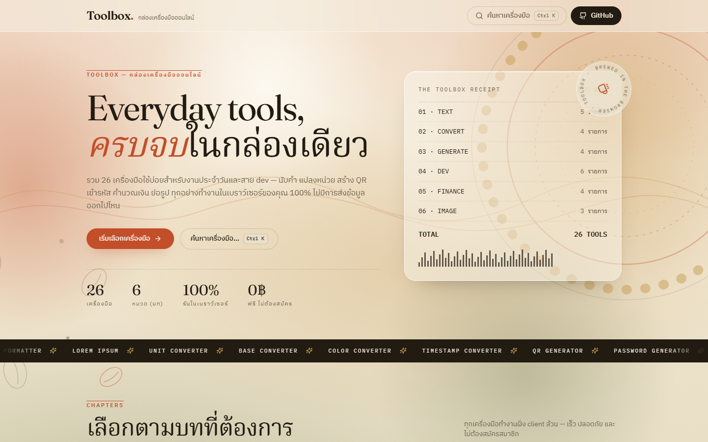
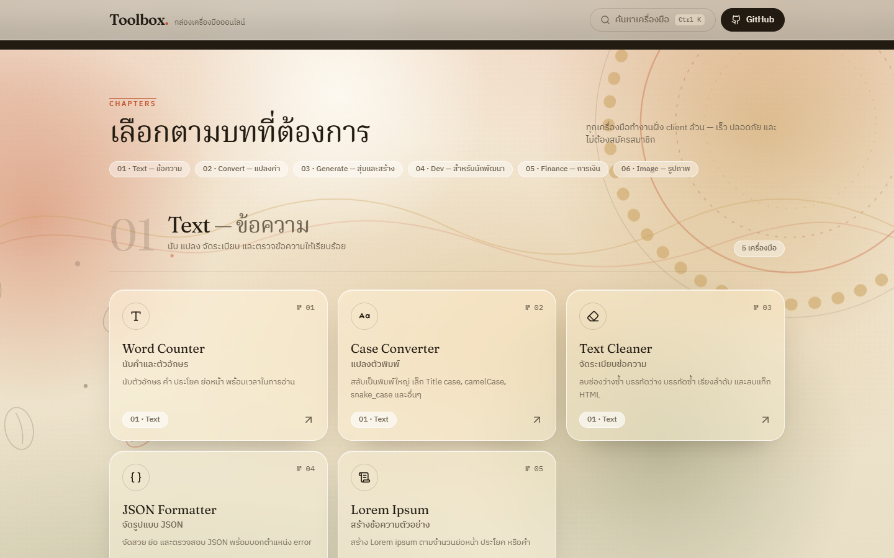
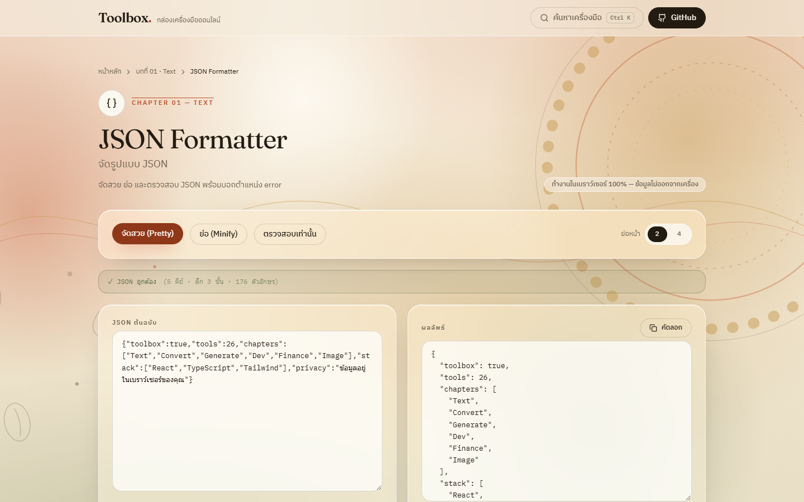

<div align="center">

# ☕ Toolbox.

### Everyday tools, ครบจบในกล่องเดียว

**26 เครื่องมือใช้บ่อยสำหรับงานประจำวันและสาย dev** — ทำงานในเบราว์เซอร์ของคุณ 100%
ไม่มีเซิร์ฟเวอร์ · ไม่มีบัญชี · ไม่มี tracking · ข้อมูลไม่ออกจากเครื่อง

[](https://github.com/Poshzz/toolbox/actions/workflows/deploy.yml)
[](https://poshzz.github.io/toolbox/)


<br/>

[](https://poshzz.github.io/toolbox/)

<a href="https://poshzz.github.io/toolbox/"></a>

</div>

---

## ✨ จุดเด่น — Highlights

| | |
|:--|:--|
| 🔐 **Private by default** | ทุกการคำนวณรันในเบราว์เซอร์ — ข้อมูลของคุณไม่เคยออกจากเครื่อง (zero upload) |
| ⚡ **Instant** | Static site ล้วน ไม่ต้องสมัคร ไม่ต้องล็อกอิน ไม่ต้องรอโหลด |
| 🎨 **Editorial design** | ธีมกาแฟ · พื้นหลังงานศิลป์เคลื่อนไหว + parallax + การ์ดกระจกฝ้า |
| ⌨️ **Keyboard-first** | กด `Ctrl` + `K` ค้นหาเครื่องมือได้จากทุกหน้า |
| 🇹🇭 **ไทย–อังกฤษ** | UI สองภาษา ทั้งชื่อเครื่องมือและคำอธิบาย |
| 🧩 **One-file tools** | เพิ่มเครื่องมือใหม่ = 1 ไฟล์ + 1 entry — ที่เหลืออัปเดตอัตโนมัติ |

## 🧰 เครื่องมือ — 26 tools · 6 chapters

| # | Chapter | เครื่องมือ | |
|:-:|:--|:--|:-:|
| 01 | **Text** · ข้อความ | Word Counter · Case Converter · Text Cleaner · JSON Formatter · Lorem Ipsum | 5 |
| 02 | **Convert** · แปลงค่า | Unit Converter · Base Converter · Color Converter · Timestamp Converter | 4 |
| 03 | **Generate** · สุ่มและสร้าง | QR Generator · Password Generator · UUID Generator · Random Picker | 4 |
| 04 | **Dev** · สำหรับนักพัฒนา | Base64 · Hash Generator · URL Tools · JWT Decoder · Diff Checker · Regex Tester | 6 |
| 05 | **Finance** · การเงิน | Percentage Calculator · Interest Calculator · Bill Split · Loan Calculator | 4 |
| 06 | **Image** · รูปภาพ | Image Resizer · Image Converter · Image Info | 3 |
| | | **รวม** | **26** |

<details>
<summary><b>▸ ดูรายละเอียดเครื่องมือทั้ง 26 ตัว — Full list</b></summary>

<br/>

**01 · Text — ข้อความ**
- **Word Counter** — นับคำ ตัวอักษร และประโยค (รองรับภาษาไทย)
- **Case Converter** — แปลงตัวพิมพ์ใหญ่–เล็ก หลายรูปแบบ
- **Text Cleaner** — จัดระเบียบข้อความ เช่น ลบช่องว่างซ้ำ บรรทัดว่าง
- **JSON Formatter** — จัดสวย/ย่อ/ตรวจสอบ JSON พร้อมบอกตำแหน่ง error
- **Lorem Ipsum** — สร้างข้อความตัวอย่างสำหรับงานออกแบบ

**02 · Convert — แปลงค่า**
- **Unit Converter** — แปลงหน่วยวัด ความยาว น้ำหนัก อุณหภูมิ ฯลฯ
- **Base Converter** — แปลงฐานตัวเลข 2–36 (รองรับเลขติดลบ)
- **Color Converter** — แปลงสี HEX / RGB / HSL พร้อมพรีวิว
- **Timestamp Converter** — แปลง Unix timestamp ↔ วันที่และเวลา

**03 · Generate — สุ่มและสร้าง**
- **QR Generator** — สร้าง QR Code ดาวน์โหลดได้ทันที
- **Password Generator** — สุ่มรหัสผ่านที่ปลอดภัยตามเงื่อนไข
- **UUID Generator** — สร้าง UUID v4
- **Random Picker** — สุ่มเลข เต๋า จับฉลาก พร้อมช่วงตัวเลขกว้าง ๆ

**04 · Dev — สำหรับนักพัฒนา**
- **Base64** — เข้ารหัส/ถอดรหัส Base64 (รองรับ Unicode)
- **Hash Generator** — MD5 / SHA-1 / SHA-256 / SHA-512
- **URL Tools** — เข้ารหัส/ถอดรหัส URL และแยกส่วนประกอบ
- **JWT Decoder** — ถอดและตรวจ JWT (HS256) ในเบราว์เซอร์
- **Diff Checker** — เทียบข้อความทีละบรรทัด แบบ side-by-side
- **Regex Tester** — ทดสอบ Regex พร้อมไฮไลต์ผลที่ตรง

**05 · Finance — การเงิน**
- **Percentage Calculator** — คำนวณเปอร์เซ็นต์ทุกรูปแบบที่ใช้บ่อย
- **Interest Calculator** — ดอกเบี้ยเงินฝาก/เงินกู้ ทั้งแบบง่ายและทบต้น
- **Bill Split** — หารบิลพร้อมทิป แสดงยอดต่อคน
- **Loan Calculator** — ค่างวดผ่อนต่อเดือนจากยอดเงินและดอกเบี้ย

**06 · Image — รูปภาพ**
- **Image Resizer** — ย่อ/ขยายรูปในเบราว์เซอร์ ไม่มีการอัปโหลด
- **Image Converter** — แปลงไฟล์ PNG / JPEG / WebP
- **Image Info** — ขนาด มิติ และข้อมูลไฟล์ของรูป

</details>

## 📸 ตัวอย่างหน้าจอ — Screenshots

| เลือกตามบท — Chapters | หน้าเครื่องมือ — Tool page |
|:--:|:--:|
|  |  |

## ⚙️ Tech Stack

| Layer | Stack |
|:--|:--|
| **Core** | React 19 · TypeScript 5.7 · Vite 6 |
| **Styling** | Tailwind CSS v4 + ธีมกาแฟที่ออกแบบเอง (glass + parallax engine เขียนสด) |
| **Routing** | react-router-dom v7 — HashRouter ใช้ได้ทุก subpath ของ GitHub Pages |
| **Libraries** | qrcode · lucide-react · Web Crypto API · Canvas API |
| **Backend** | ไม่มี. ศูนย์. Zero. 🎉 |
| **Deploy** | GitHub Actions → GitHub Pages (อัตโนมัติทุก push ขึ้น `main`) |

## 📁 โครงสร้างโปรเจกต์

```
src/
├── components/         # Header, Footer, SearchDialog, ToolCard, ui kit
│   └── Background.tsx  # พื้นหลังศิลปะ + parallax engine (requestAnimationFrame)
├── data/
│   ├── tools.ts        # registry: CHAPTERS + TOOLS (จุดเดียวที่ต้องแก้เวลาเพิ่มเครื่องมือ)
│   └── site.ts         # ชื่อเว็บ + repo URL
├── lib/                # utils · md5 (เขียนเอง verify เทียบ node:crypto) · diff (LCS)
└── pages/
    ├── Home.tsx
    └── tools/          # 1 ไฟล์ต่อ 1 เครื่องมือ (lazy-load ทั้งหมด)
```

## 🚀 เริ่มพัฒนา

ต้องมี **Node 20+** จากนั้น:

```bash
git clone https://github.com/Poshzz/toolbox.git
cd toolbox
npm install
npm run dev        # dev server → http://localhost:5173
npm run build      # typecheck (tsc) + build → dist/
npm run preview    # ลองของจริงจาก dist/
```

## ➕ เพิ่มเครื่องมือใหม่ (ใช้เวลา 3 นาที)

1. สร้าง component ใหม่ใน `src/pages/tools/`
2. เพิ่ม 1 entry ใน `TOOLS` ที่ `src/data/tools.ts`
3. เขียน UI ตามใจ แล้ว push — หน้าเว็บ ค้นหา ปุ่มก่อน/ถัดไป อัปเดตอัตโนมัติ

```ts
// src/data/tools.ts — ตัวอย่าง entry
{
  id: 'my-tool',
  name: 'My Tool',
  th: 'เครื่องมือของฉัน',
  desc: 'อธิบายสั้น ๆ ว่าเครื่องมือนี้ทำอะไร',
  chapter: 'dev',            // text | convert | generate | dev | finance | image
  icon: Wand2,               // ไอคอนจาก lucide-react
  keywords: 'คำค้น ภาษาไทย english',
  component: lazy(() => import('../pages/tools/MyTool')),
}
```

## 🔐 Privacy by design

> **ข้อมูลของคุณอยู่ในเบราว์เซอร์เสมอ** — ทุกเครื่องมือคำนวณฝั่ง client ล้วน ๆ
> ไม่มีการอัปโหลด ไม่มี cookie ไม่มี analytics และไม่มี backend ให้ข้อมูลไหลไปถึง

อยากพิสูจน์? เปิด **DevTools → Network** แล้วลองใช้เครื่องมือต่าง ๆ — จะไม่เห็น request ที่ส่งข้อมูลของคุณออกไปเลย

## 🙏 เครดิต

- แรงบันดาลใจดีไซน์: **"Coffee Cycle"** โดย **Delta Cafés** (ออกแบบโดย Bürocratik)
- ไอคอน: [lucide-react](https://lucide.dev) · QR Code: [qrcode](https://www.npmjs.com/package/qrcode)
- เว็บนี้**ฟรีสำหรับทุกการใช้งาน** — โค้ดเผยแพร่เพื่อการเรียนรู้ หากอยากนำไปใช้ต่อ ทักทายเจ้าของ repo ได้เลยครับ
- **© 2026 Poshzz**

---

<div align="center">
<sub>สร้างด้วย ☕ + React + Tailwind · <i>Your data never leaves your browser.</i></sub>
</div>
